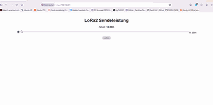
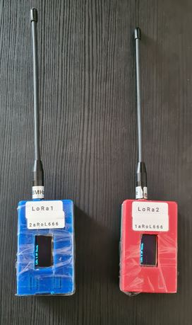
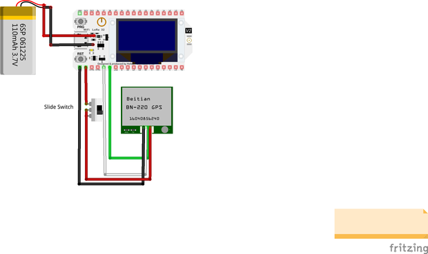

# LoRa Transceiver

A compact, battery-powered LoRa messaging device for sending short text messages over long distances — with Bluetooth smartphone connectivity, encrypted communication and GPS position sharing.

## Demo

The video below shows the two LoRa transceivers in operation.

**Demo video:** [`LoRa-Transceiver.mp4`](./assets/LoRa-Transceiver.mp4)

## Project overview

LoRa (Long Range) is a low-power radio modulation technology designed for transmitting small amounts of data over long distances. Unlike Wi-Fi or cellular networks, LoRa can be used for direct device-to-device communication without requiring an internet connection or a cellular provider.

This project uses LoRa for exchanging text messages between compatible transceivers. A smartphone connects to the device over Bluetooth and can be used to compose and receive messages with a Bluetooth messaging app of your choice.

### Features

- Long-range text messaging between compatible LoRa devices.
- Bluetooth connection to a smartphone.
- Incoming messages are shown in the smartphone messenger and on the device's OLED display.
- AES-encrypted message communication.
- GPS position sharing and remote position requests.
- A local Wi-Fi access point with a web interface for adjusting radio transmit power.
- Rechargeable battery-powered operation.

## How it works

1. Pair your smartphone with the transceiver over Bluetooth.
2. Open a compatible Bluetooth messenger app.
3. Send a message — the device transmits it over LoRa.
4. Another compatible transceiver receives and decrypts the message.
5. The received message is displayed on its OLED and forwarded to the connected smartphone.

Both devices must use compatible radio settings and the same encryption key.

## GPS commands

The firmware recognises the following text commands (case-insensitive):

| Command | Function |
| --- | --- |
| `gps` | Sends the local device's current GPS position to other compatible devices. |
| `gpsr` | Requests the other devices to send their GPS position. |

A valid encryption key is required to decrypt received position messages. GPS functionality requires a connected and functioning GPS module with a valid position fix.

## Encryption

Messages are encrypted using AES. The encryption key is defined in the source code in the `AES encryption` section.

**Important:** Change the example/default key before using the devices outside a test environment. Every device that should communicate with one another must use the same key. Keep the key private and do not publish it in your repository.

Changing or obscuring the hexadecimal values in source code is not a substitute for secure key management. Anyone with access to the firmware or source may be able to recover a hard-coded key.

## Wi-Fi configuration interface

The device also starts a hidden Wi-Fi access point:

| Setting | Default |
| --- | --- |
| SSID | `LoRa1` (hidden) |
| Password | `1aRoL666` |
| Default transmit power | 14 dBm |
| Maximum configured transmit power | 20 dBm (hardware limit stated for the Heltec board) |

Connect to the access point and open the device's configuration webpage. Use the slider to adjust the transmit power.

> **Security note:** The default Wi-Fi password is included here for setup convenience and is therefore public. Change it in the firmware before deploying the device. A hidden SSID does not provide meaningful security.

## Hardware

The build requires soldering.

| Component | Description |
| --- | --- |
| LoRa board | HELTEC WiFi LoRa 32 V2 (ESP32 / SX127x, 868 MHz version) |
| GPS receiver | Beitian BN-220 M8N GPS module |
| Battery | MakerFocus 3000 mAh, 3.7 V rechargeable lithium battery |

### Assembled devices

### Circuit diagram

Use the circuit diagram as a wiring reference when assembling the hardware.

## Enclosure

The enclosure can be 3D printed. Suitable printable files are available here:

[LoRa transceiver enclosure — Thingiverse](https://www.thingiverse.com/thing:6485907)

Some adjustments may be necessary, particularly around the power slide switch. Check the fit of your own components before printing the final enclosure.

## Radio and regulatory information

This project is intended for the 868 MHz version of the hardware for use in the European region. LoRa operates in licence-exempt frequency bands, but licence-exempt does **not** mean unrestricted.

Before transmitting, check the current national regulations and the applicable EU rules for the exact frequency sub-band, maximum permitted radiated power (EIRP), antenna gain, duty-cycle or listen-before-talk requirements. The permitted settings can vary by sub-band and country.

The firmware's 20 dBm setting is a hardware capability, **not** a statement that 20 dBm EIRP is legally permitted in every 868 MHz sub-band. Antenna gain must also be taken into account. Configure the device so that its complete radio setup complies with the rules where it is operated.

Use the device responsibly and do not transmit on frequencies or at power levels that you are not authorised to use.

## Disclaimer

This project is provided for educational and experimental purposes. You are responsible for the assembly, configuration and lawful operation of your device. Radio performance and range depend on antenna, location, terrain, interference, radio parameters and local conditions. No specific communication range is guaranteed.

The hardware includes a rechargeable lithium battery. Use a suitable charger and observe the battery manufacturer's safety instructions. Incorrect wiring, charging or handling can cause damage, fire or injury.

## Credits

- LoRa transceiver hardware: [Heltec WiFi LoRa 32 V2](https://heltec.org/)
- GPS receiver: [Beitian BN-220](https://www.beitian.com/)
- 3D-printable enclosure: [Thingiverse — Thing 6485907](https://www.thingiverse.com/thing:6485907)
